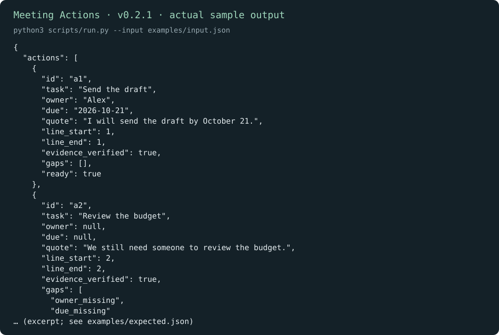
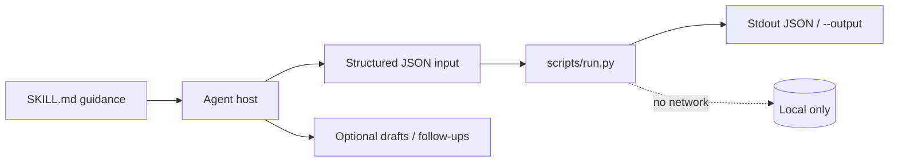
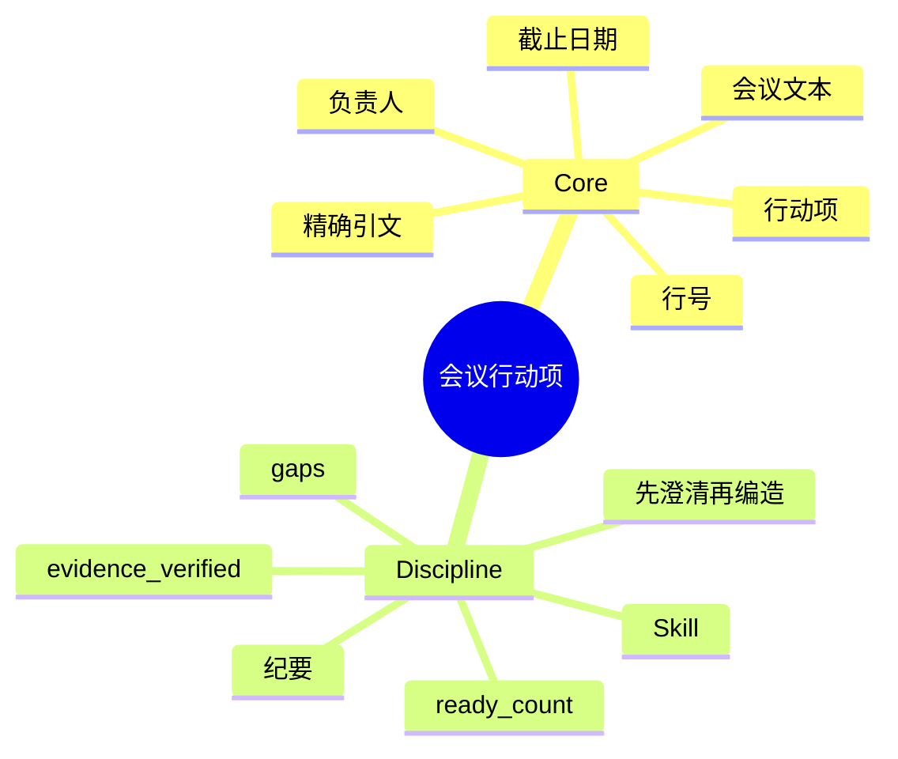

# 会议行动项

[English](README.md) · [中文](README.zh-CN.md) · **v0.2.1**

[](https://github.com/KarmenLoop/skill-meeting-actions/actions/workflows/checks.yml)
[](https://github.com/KarmenLoop/skill-meeting-actions/releases/latest)
[](https://www.python.org/downloads/)
[](LICENSE)
[](docs/COMPATIBILITY.md)

**让每条行动项都拴在支撑它的原文上——引文、行号、负责人与截止日期。**

一套 Agent Skill，外加本地证据校验：候选行动项须对照会议记录文本通过校验，才计入就绪。 导出（或会议文本、diff、账本、事件日志、JUnit XML）留在本地；辅助程序只用标准库，从不发起网络连接。Skill 层教宿主*何时*准备输入、*如何*陈述结果，以及在用户未授权的副作用前*停在哪里*。

由 [KarmenLoop](https://github.com/KarmenLoop) / [KARMENLOOP](https://karmenloop.com) 维护。当前发布：**[v0.2.1](https://github.com/KarmenLoop/skill-meeting-actions/releases/tag/v0.2.1)**。许可证：**MIT**。



*v0.2.1 真实本地输出渲染图。[examples/expected.json](examples/expected.json) · [图像出处](docs/images/provenance.json)。*

[下载 v0.2.1](https://github.com/KarmenLoop/skill-meeting-actions/releases/tag/v0.2.1) · [英文教程](docs/tutorial.en.md) · [中文教程](docs/tutorial.zh-CN.md) · [输入契约](docs/input.zh-CN.md)

---

## 为什么做这个

会议纪要若凭空编造负责人或截止日期，会留下隐性债务；Agent 把转述当成承诺时，债务会被放大。

本仓库把**解释**（你或模型提出候选行动）与**校验**（辅助程序核对引文位置与完整度）拆开。缺失的负责人或截止日期保持 `null`——可见，而不是瞎猜。

只有证据通过且缺口已填的项才算就绪；其余留在澄清队列，支撑引文仍然附着。

---

## 快照

| | |
|---|---|
| **安装内容** | Skill 树 + `scripts/run.py` 证据辅助程序 + `install.py` |
| **运行时** | Python **3.9+**，仅标准库 |
| **网络** | **无** |
| **输入** | UTF-8 JSON：`transcript` + `actions[]`（`id`、`task`、`owner`、`due`、`quote`、`line_start`/`line_end`） |
| **输出** | 每项 `evidence_verified`、`gaps`、`ready`；汇总 `ready_count` |
| **安装宿主** | `codex` · `deepseek` · `grok` · `agents` |
| **包标识** | `karmen-meeting-actions` |
| **许可证** | MIT |

---

## 是 / 不是

| 是 | 不是 |
|---|---|
| 对提交的会议文本 + 行动项做证据核对 | 音频转写或会议机器人 |
| 精确引文 + 1 起算闭区间行号校验 | 语义上「隐含承诺」探测 |
| 负责人 / 截止日可空（缺口可见） | 编造负责人或日历同步 |
| 离线标准库辅助程序 | 任务看板 SaaS 或自动建单 |
| Skill 指导纪要与跟进 | 未经请求就给与会者发邮件的权限 |

---

## 工作方式

两层有意分开：

1. **方法层（`SKILL.md`）** — 何时调用、如何准备诚实输入、交付什么，以及哪些副作用在没有新的用户授权时仍禁止。
2. **确定性辅助程序（`scripts/run.py`）** — 校验 UTF-8 JSON 契约（最大 10 MiB），本地计算，打印到 stdout（或新的 `--output`），非法输入以 `2` 退出。





### 流程

1. **从 1 编号**会议文本行。捕获明确承诺；不要给每个讨论点都硬塞行动项。
2. **附着**每项行动的确切引文与 `line_start`..`line_end`。未知负责人/截止日记为 `null`。
3. **运行**辅助程序。引文对不上时重读原文——不要改会议文本去迁就行动项。
4. **交付**含决策、就绪行动与待澄清项的纪要。仅在用户要求的范围内建任务或发送纪要。

### 示例证明什么

Alex 的草稿任务已就绪。预算审阅仍带支撑引文但未就绪——负责人和截止日期缺失。

退出码 `0` 表示处理完成——不表示业务上「全部通过」。

---

## 快速开始

从 [v0.2.1 发布页](https://github.com/KarmenLoop/skill-meeting-actions/releases/tag/v0.2.1) 下载 `karmen-meeting-actions-v0.2.1.zip` 与对应 `.sha256`，校验哈希后解压。需要 Python 3.9+。

```sh
python3 scripts/run.py --version
python3 scripts/run.py --input examples/input.json
```

期望版本串：`karmen-meeting-actions 0.2.1`。

可选：安装到会扫描 skills 目录的宿主（目标已存在则拒绝）：

```sh
python3 install.py --host agents
# 亦可：--host codex | deepseek | grok
# 或：  --destination /精确/新目录
```

完全可以不借助 AI 宿主直接跑辅助程序。宿主发现与调用方式仍因产品而异——见 [docs/tutorial.zh-CN.md](docs/tutorial.zh-CN.md) 与 [docs/COMPATIBILITY.md](docs/COMPATIBILITY.md)。

管道与版本探测：

```sh
python3 scripts/run.py --input - < examples/input.json
python3 scripts/run.py --version
```

---

## 用在你自己的工作上

准备新载荷前先读 [docs/input.zh-CN.md](docs/input.zh-CN.md)（或 [docs/INPUT.md](docs/INPUT.md)）。

- 行号从 1 起算且为闭区间。
- 把引文挪到错误行，观察 `evidence_verified`，再恢复。
- 只有完整且证据通过的项会计入 `ready_count`。
- 音频转写与出席记录不在本包范围内。

辅助程序不需要模型账号、API 密钥或网络。AI 宿主有自己的数据与权限设置；本 skill 不授予发送、购买、发布或改权限的权力。

---

## 文档地图

| 文档 | 何时使用 |
|---|---|
| [教程（中文）](docs/tutorial.zh-CN.md) · [English](docs/tutorial.en.md) | 下载、安装、练习、升级、卸载 |
| [输入/输出契约（中文）](docs/input.zh-CN.md) · [EN](docs/INPUT.md) | 字段语义与示例 |
| [兼容性](docs/COMPATIBILITY.md) | 宿主安装路径与未验证边界 |
| [验证](docs/VALIDATION.md) | 实际跑过什么 |
| [来源](docs/SOURCES.md) | 设计背后的研究笔记 |
| [变更日志](CHANGELOG.md) | 发布历史 |
| [贡献](CONTRIBUTING.md) · [支持](SUPPORT.md) · [安全](SECURITY.md) | 协作与报告 |

---

## 验证（如实）

基线见 [docs/VALIDATION.md](docs/VALIDATION.md)：2026-10-18 (UTC) · Python 3.9.6 · macOS arm64 (see docs/VALIDATION.md)。

| 检查 | 结果 |
|---|---|
| `python3 scripts/run.py --input examples/input.json` | 退出 0；夹具与实跑输出对齐 |
| `python3 -m unittest discover -s tests -v` | 维护者环境退出 0 |
| `skill-creator` 快速校验 | 元数据通过 |

**未声称：** 每个支持宿主内的已登录对话、在线账号连接器，或 Windows/Linux 宿主 UI 全覆盖。安装在临时目录测过；模型如何解释仍是宿主责任。依赖调用前请确认精确的 `SKILL.md` 已被发现。

CI：[`.github/workflows/checks.yml`](https://github.com/KarmenLoop/skill-meeting-actions/actions/workflows/checks.yml)。

---

## 常见问题

### 一句话：会议行动项是什么？

MIT Skill + 离线辅助程序：对照会议文本引文与完整度校验行动项，通过后才计入就绪。

### 能把录音变成纪要吗？

不能。需要文本会议记录与候选行动。转写与出席不在范围内。

### 会编造负责人吗？

不会。未知负责人或截止日必须为 `null`。Skill 只追问阻塞下一步的缺口。

### 结果写到哪里？

stdout 上的 JSON，或新的 `--output` 文件。从不覆盖已有文件。

### 如何装进宿主？

`python3 install.py --host agents`（也支持 `codex` / `deepseek` / `grok`）。目标已存在则拒绝。

### 示例结果能证明纪要已发出吗？

不能。本地 JSON 从不证明外部消息或工单已创建。

---

## 许可与联系

[MIT](LICENSE)。再分发时请保留许可证与 [声明](NOTICE.md)。

[karmenloop.com](https://karmenloop.com) · [GitHub @KarmenLoop](https://github.com/KarmenLoop) · [info@karmenloop.com](mailto:info@karmenloop.com)

KARMENLOOP Official Team · 上海

<!-- Copyright (C) 2026 KARMENLOOP Official Team
SPDX-License-Identifier: MIT -->
